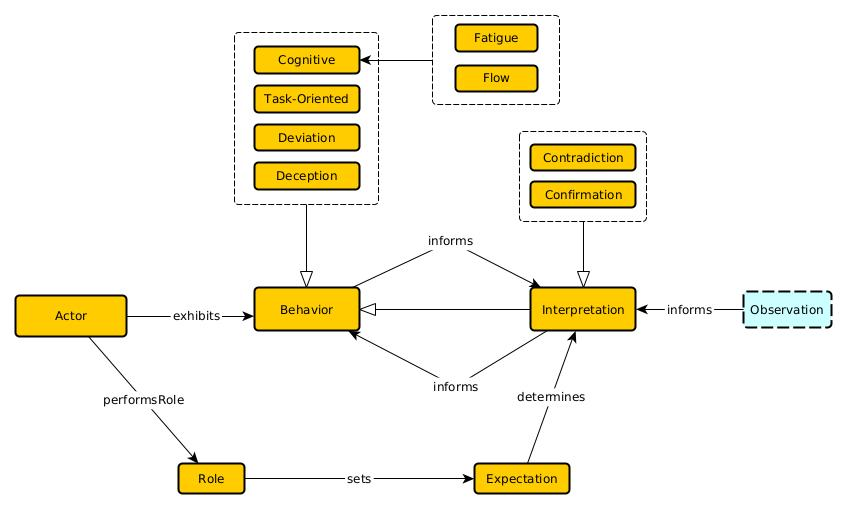
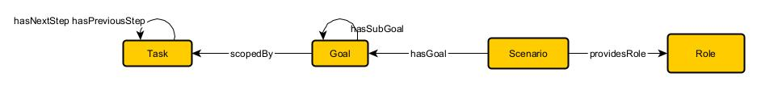
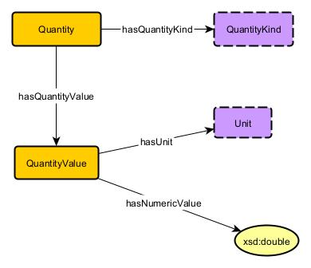

# BIO - Behavior Interpretation Ontology

## Survey

### Axioms

#### Survey hasItem SurveyItem  
* disjoint: `Survey DisjointWith SurveyItem`
Nothing can be a Survey and a SurveyItem.

* scoped domain: `hasItem some SurveyItem SubClassOf Survey`  
Anything that has a SurveyItem must be a Survey

* Scoped range: `Survey SubClassOf hasItem only SurveyItem`  
Any Survey must have a Survey Item.

* Existential : `Survey SubClassOf hasItem some SurveyItem`  

* Qualified Scoped Funcationality: `Survey SubClassOf hasItem min 1 SurveyItem`  
  Survey has atleast one SurveyItem

#### Response answers SurveyItem  

* disjoint: `Response DisjointWith SurveyItem`  
  Nothing can be Response and a Survey question.
  
* Scoped domain: `answers some SurveyItem SubClassOf Response`  
Anything that answers a SurveyItem must be a Response.

* Scoped range: `Response SubClassOf answers only SurveyItem`  
Any Response must answer a SurveyItem.

* Existential: `Response SubclassOf answers some SurveyItem`  

* Inverse Existential: `SurveyItem SubClassOf inverse answers some Response`  

* Functionality: `Response SubClassOf answers min 1 SurveyItem`  
  Each response answers min one Survey question.
  
*Inverse Qualified Scoped Functionality: `SurveyItem SubClassOf inverse answers exactly 1 Response`   

#### Actor takesSurvey Survey  

* disjoint : `Actor DisjointWith Survey`
Nothing can be both an Actor and a Survey

* scoped domain: `takesSurvey some Survey subclassOf Actor`  
Anything that takes a Survey must be an Actor.

* Scoped range: `Actor subClassOf takesSurvey only Survey`  
Anything that an Actor takes must be a Survey.

* Inverse Existential : `Survey SubClassOf Inverse answers some Actor`  

* Structural Tautology: `Actor subClassOf takesSurvey min 0 Survey`  
  An Actor may take zero or more Surveys.

## Instrumentation

### Axioms 
#### Actor wears Wearable  

* disjoint: `Actor DisjointWith Wearable`  
Nothing can be both an Actor and a Wearable.

* scoped domain: `wears some Wearable SubClassOf Actor`  
Anything that wears a Wearable must be an Actor.

* scoped range: `Actor SubClassOf wears only Wearable`  
Anything an actor wears but be a wearable.

* Inverse Existential: `Wearable subClassOf inverse wears some Actor`  

* Structural Tautology: `Actor SubClassOf wears min 0 Wearable`  
  An Actor may wear zero or more Wearables.
  

#### Task requiresEquipment Equipment

* disjoint: `Task  DisjointWith Equipment`  
  Nothing can be both a Task and a piece of Equipment.

* scoped domain: `requiresEquipment some Equipment SubClassOf Task`  
Anything that requires Equipment must be a Task.

* scoped range: `Task SubClassOf requiresEquipment only Equipment`  
  Anything a Task requires must be Equipment.

* Structural Tautology: `Task SubClassOf requiresEquipment min 0 Equipment`  
  A Task may require zero or more Equipment.

#### Wearable isLocated Location

* disjoint: `Wearable DisjointWith Location`  
  Nothing can be a wearable and a body part(location).
  
* Scoped domain: `isLocated some Location SubClassOf Wearable`  
  Anything located at a body location must be a wearable.
  
* Scoped range: `Wearable SubClassOf isLocated only Location`  
  Anything a wearable is located at must be a body location.
  
* Existential : `Wearable SubClassOf isLocated some Location`  
  Every wearable is located at at least one body location.
  
* Qualified Scoped Functionality: `Wearable SubClassOf isLocated min 1 Location`  

#### Platform hosts Sensor

* disjoint: `Platform DisjointWith Sensor`  
  Nothing can be a platform and a sensor.
  
* Scoped range: `Platform SubClassOf hosts only Sensor`  
  Anything a sensor is located at must be a platform.

* Functionality: Platform SubClassOf hosts min 1 Sensor
Each platform hosts a minimum of one sensor.

## Behavior Assessment

### Axioms
#### Actor exhibits Behavior
* Disjoint: `Actor DisjointWith Behavior`  
  Nothing can be both an actor and a behavior.
  
* Scoped domain: `exhibits some Behavior SubClassOf Actor`  
  Anything that exhibits a behavior must be an actor.
  
* Scoped range: `Actor SubClassOf exhibits only Behavior`  
  Anything an actor exhibits must be a behavior.
  
* Structural tautology: `Actor SubClassOf exhibits min 0 Behavior`  
  An actor may exhibit zero or more behaviors.
  
* Inverse Qualified Scoped Functionality: `Behavior SubClassOf inverse exhibits min 1 Actor`  
  Every behavior is exhibited by at least one actor.

  
#### Observation informs Interpretation
NEED TO DISCUSS
* Scoped domain: `informs some Interpretation SubClassOf Observation`  
  Anything that informs a interpretation is an observation or a behavior.

* Scoped range: `Observation SubClassOf informs only Interpretation`  
  Anything an observation informs must be a behavior or an interpretation.

* Inverse Qualified Scoped Functionality: `Interpretation SubClassOf inverse informs min 1 Observation`  
  Every interpretation is informed by at least one observation.
  
* Structural tautology: `Observation SubClassOf informs min 0 Interpretation` 
  An observation may inform zero or more interpretations.

#### Behavior informs Interpretation
NEED TO DISCUSS
* Scoped domain: `informs some Interpretation SubClassOf Behavior`  
  Anything that informs an interpretation is a behavior or an observation.
  
* Scoped range: `Behavior SubClassOf informs only Interpretation`  
  Anything a behavior informs must be an interpretation.

* Inverse Qualified Scoped Functionality: `Interpretation SubClassOf inverse informs min 1 Behavior`  
  Every interpretation is informed by atleast one behavior.
  
* Functionality: Behavior SubClassOf informs min 1 Interpretation
  Each behavior informs min one interpretation.

#### Interpretation informs Behavior
* Scoped domain: `informs some Behavior SubClassOf Interpretation`  
  Anything that informs a behavior is an interpretation.

* Scoped range: `Interpretation SubClassOf informs only Behavior`  
  Anything an interpretation informs must be a behavior.

* Inverse Qualified Scoped Functionality: `Behavior SubClassOf inverse informs min 1 Interpretation`  
  Every behavior is informed by at least one interpretations.
  
* Functionality: Interpretation SubClassOf informs min 1 Behavior
  Each interpretation informs min one behavior.

#### Expectation determines Interpretation
* Disjoint: `Expectation DisjointWith Interpretation`  
  Nothing can be both an expectation and an interpretation.
  
* Scoped domain: `determines some Interpretation SubClassOf Expectation`  
  Anything that determines an interpretation must be an expectation.
  
* Scoped range: `Expectation SubClassOf determines only Interpretation`  
  Anything an expectation determines must be an interpretation.
  
* Structural tautology: `Expectation SubClassOf determines min 0 Interpretation`  
  An expectation may determine zero or more interpretations.
  
* Inverse Existential: `Interpretation SubClassOf inverse determines some Expectation`  
 Every interpretation is judged against at least one expectation.

  #### Actor performsRole Role
* Disjoint: `Actor DisjointWith Role`  
  Nothing can be both an actor and a role.
  
* Scoped domain: `exhibits some Role SubClassOf Actor`  
  Anything that performs a role must be an actor.
  
* Scoped range: `Actor SubClassOf exhibits only Role`  
  Anything an actor performs must be a role.
  
* Structural tautology: `Actor SubClassOf exhibits min 0 Roles`  
  An actor may exhibit zero or more roles.
  
* Inverse Qualified Scoped Functionality: `Role SubClassOf inverse exhibits min 1 Actor`  
  Every role is performed by at least one actor.

  #### Role sets Expectation
* Disjoint: `Role DisjointWith Expectation`  
  Nothing can be both a role and an expectation.
  
* Scoped domain: `sets some Expectation SubClassOf Role`  
  Anything that sets an expectation must be a role.
  
* Scoped range: `Role SubClassOf sets only Expectation`  
  Anything a role sets must be an expectation.
  
* Structural tautology: `Role SubClassOf sets min 0 Expectation`  
  An role may exhibit zero or more expectations.
  
* Inverse Qualified Scoped Functionality: `Expectation SubClassOf inverse sets min 1 Role`  
  Every expectaton is set by at least one role.

## Observation

### Axioms

#### Agent madeObservation Observation

* Disjoint: `Agent DisjointWith Observation`  
  Nothing can be both an agent and an observation.
  
* domain: `madeObservation some Observation SubClassOf Agent`  
  Anything that made an observation must be an agent.
  
* Range: `Agent SubClassOf madeObservation only Observation`  
  Whatever anything made must be an observation.
  
* Inverse Qualified Scoped Functionality: `Observation SubClassOf inverse madeObservation exactly 1 Agent`  

* Structural tautology: `Agent SubClassOf madeObservation min 0 Observation`  
  An agent may make zero or more observations.

#### Observation hasResult Result

* Disjoint: `Observation DisjointWith Result`  
  Nothing can be both an observation and a result.

* Scoped Domain: `hasResult some Result SubClassOf Observation`  
  Anything that has a result must be an observation.
  
* Scoped Range: `Observation SubClassOf hasResult only Result`  
  Anything an observation has as a result must be a result.
  
* Existential: `Observation SubClassOf hasResult some Result`   
  Every observation has a result.
  
* Inverse Existential: `Result SubClassOf inverse hasResult some Observation`  

* Qualified Scoped Functionality: `Observation SubClassOf hasResult min 1 Result`  

* Inverse Qualified Scoped Functionality: `Result SubClassOf inverse hasResult exactly 1 Observation`  

  
#### Observation hasFeatureOfInterest FeatureOfInterest

* Disjoint:  `Observation DisjointWith FeatureOfInterest`  
  Nothing can be both an observation and the thing it’s about.
  
* Scoped domain:  `hasFeatureOfInterest some FeatureOfInterest SubClassOf Observation`  
  Anything that has a feature of interest must be an observation.
  
* Scoped range: `Observation SubClassOf hasFeatureOfInterest only FeatureOfInterest`  
  Anything an observation is about must be a feature of interest.
  
* Existential: `Observation SubClassOf hasFeatureOfInterest some FeatureOfInterest`  
  Every observation is about at least one feature of interest.

* Qualified Scoped Functionality: `Observation SubClassOf hasFeatureOfInterest exactly 1 FeatureOfInterest`   

#### Observation observedProperty ObservableProperty

* Disjoint: `Observation DisjointWith ObservableProperty`  
Nothing can be both an observation and an observable property.

* Scoped Domain: `observedProperty some ObservableProperty SubClassOf Observation`  
Anything that has an observed property must be an observation.

* Scoped Range: `Observation SubClassOf observedProperty only ObservableProperty`  
Anything an observation is about must be an observable property.

* Existential: `Observation SubClassOf observedProperty some ObservableProperty`  
Every observation has at least one observable property.

#### ObservationCollection hasMember Observation
* Disjoint: `Observation DisjointWith ObservationCollection`  
Nothing can be both an observation and an observation collection

* Scoped Domain: `hasMember some Observation SubClassOf ObservationCollection`  
Anything that is a member of an observed property must be an observation.

* Scoped Range: `ObservatioCollection SubClassOf hasMember only Observation`  
Anything an obervation collection has as a member is an observation.

* Existential: `ObservationCollection SubClassOf hasMember some Observation`  
Every observation collection has at least one observation.

* Functionality: ObservationCollection SubClassOf hasMember min 1 Observation
Each observation collection has min one observation.

## Goal-Task

### Axioms  

#### Goal scopedBy Task
* Disjoint: `Goal DisjointWith Task`  
  Nothing can be both a task and a goal.
  
* Scoped domain: `scopedBy some Task SubClassOf Goal`  
  Anything scoped by tasks must have a goal.
  
* Scoped range: `Goal SubClassOf scopedBy only Tasks`  
  Any goal scope must be a task.
  
* Existential: `Goal SubClassOf scopedBy some Task`  
  Every goal has at least one task.
  
* Structural tautology: `Goal SubClassOf scopedBy min 0 Task`  
  A goal may be scoped by zero or more tasks.

#### Scenario hasGoal Goal
* Disjoint: `Scenario DisjointWith Goal`  
  Nothing can be both a scenario and a goal.
  
* Scoped domain: `hasGoal some Goal SubClassOf Scenario`  
  Anything that has a goal must have a scenario.
  
* Structural tautology: `Scenario SubClassOf scopedBy min 0 Goal`  
  A scenario may have zero or more goals. 

  
#### Scenario providesRole Role
* Disjoint: `Scenario DisjointWith Role`  
  Nothing can be both a scenario and a role.
  
* Scoped domain: `providesRole some Role SubClassOf Scenario`  
  Anything that has a role must have a scenario.
  
* Structural tautology: `Scenario SubClassOf providesRole min 0 Role`  
  A scenario may have zero or more roles.

## Quantity

### Axioms
#### Quantity hasQuantityValue QuantityValue
* Disjoint: `Quantity DisjointWith QuantityValue`  

* Scoped Domain: `hasQuantityValue some QuantityValue SubClassOf Quantity`  

* Scoped Range: `Quantity subClassOf hasQuantityValue only QuantityValue`  

* Existential: `Quantity SubClassOf hasQuantityValue some QuantityValue`  

* Qualified Scoped Functionality: `Quantity SubClassOf hasQuantityValue exactly 1 QuantityValue`  

#### Quantity hasQuantityKind QuantityKind
* Disjoint: `Quantity DisjointWith QuantityKind`  
  Nothing can be both a measured amount and a kind of quantity.
  
* Scoped domain: `hasQuantityKind some QuantityKind SubClassOf Quantity`  
  Anything that has a quantity kind must be a quantity.
  
* Scoped range: `Quantity SubClassOf hasQuantityKind only QuantityKind`  
  Anything a quantity has as its kind must be a quantity kind.
  
* Existential: `Quantity SubClassOf hasQuantityKind some QuantityKind`  
  Every quantity has a kind.

*  Qualified Scoped Functionality: `Quantity SubClassOf hasQuantityKind exactly 1 QuantityKind`  
  Every quantity has exactly one kind

#### QuantityValue hasUnit Unit

* Disjoint : `QuantityValue DisjointWith Unit`  

* Scoped Domain: `hasUnit some Unit SubClassOf QuantityValue`  

* Scoped Range: `QuantityValue SubClassOf hasUnit only Unit`  

* Existential: ` QuantityValue SubClassOf hasUnit some Unit`  

* Qualified Scoped Functionality: `QuantityValue SubClassOf hasUnit exactly 1 Unit`  

## Identifier

### Axioms
#### Agent hasIdentifier Identifier
* Disjoint: `Quantity DisjointWith Identifier`  

* Scoped Domain: `hasIdentifier some Identifier SubClassOf Agent`  

* Scoped Range: `Agent subClassOf hasIdentifier only Identifier`  

* Existential: `Agent SubClassOf hasIdentifier some Identifier`  

* Qualified Scoped Functionality: `Agent SubClassOf hasIdentifier exactly 1 Identifier`  

#### Identifier hasIdentifierType IDType
* Disjoint: `Identifier DisjointWith IDType`  
  Nothing can be both an identifier type and an identifier.
  
* Scoped domain: `hasIdentifierType some IDType SubClassOf Identifier`  
  Anything that has an identifier type must be an identifier.
  
* Scoped range: `Identifier SubClassOf hasIdentifierType only IDType`  
  Anything an identifier has as its type must be a identifier type.
  
* Existential: `Identifier SubClassOf hasIdentifierType some IDType`  
  Every identifer has a type.

*  Qualified Scoped Functionality: `Identifier SubClassOf hasIdentifierType exactly 1 IDType`  
  Every identifier has exactly one type

## DataTransformation

### Axioms
#### Agent hasIdentifier Identifier
* Disjoint: `Quantity DisjointWith Identifier`  

* Scoped Domain: `hasIdentifier some Identifier SubClassOf Agent`  

* Scoped Range: `Agent subClassOf hasIdentifier only Identifier`  

* Existential: `Agent SubClassOf hasIdentifier some Identifier`  

* Qualified Scoped Functionality: `Agent SubClassOf hasIdentifier exactly 1 Identifier`  

#### Result hasIdentifierType DataType
* Disjoint: `Result DisjointWith DataType`  
  Nothing can be both a DataType and a Result.

  SHOULD PROBABLY DELETE THIS ONE
* Scoped domain: `hasDataType some DataType SubClassOf Result`  
  Anything that has a DataType must be a Result.
  
* Scoped range: `Result SubClassOf hasDataType only DataType`  
  Anything a Result has as its type must be a DataType.
  
* Existential: `Result SubClassOf hasDataType some DataType`  
  Every Result has a type.

*  Qualified Scoped Functionality: `Result SubClassOf hasDataType exactly 1 DataType`  
  Every Result has exactly one type
