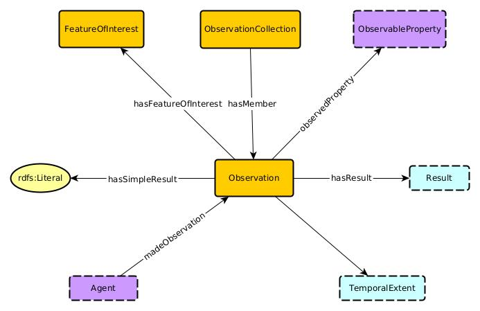

# BIO - Behavior Interpretation Ontology

## Survey

### Axioms

#### Survey hasItem SurveyItem  

* disjoint: `Survey DisjointWith SurveyItem`

* scoped domain: `hasItem some SurveyItem SubClassOf Survey`  
Anything that has a SurveyItem must be a Survey

* Scoped range: `Survey SubClassOf hasItem only SurveyItem`  

* Existential : `Survey SubClassOf hasItem some SurveyItem`  

* Qualified Scoped Funcationality: `Survey SubClassOf hasItem min 1 SurveyItem`  
  Survey has atleast one SurveyItem

#### Response answers SurveyItem  

* disjoint: `Response DisjointWith SurveyItem`  
  Nothing can be Response and a Survey question.
  
* Scoped domain: `answers some SurveyItem SubClassOf Response`  
Anything that answers a SurveyItem must be a Response.

* Scoped range: `Response SubClassOf answers only SurveyItem`  

* Existential: `Response SubclassOf answers some SurveyItem`  

* Inverse Existential: `SurveyItem SubClassOf inverse answers some Response`  

* Functionality: `Response SubClassOf answers min 1 SurveyItem`  
  Each response answers min one Survey question.
  
*Inverse Qualified Scoped Functionality: `SurveyItem SubClassOf inverse answers exactly 1 Response`   

#### Actor takesSurvey Survey  

* disjoint : `Actor DisjointWith Survey`

* scoped domain: `takesSurvey some Survey subclassOf Actor`  

* Scoped range: `Actor subClassOf takesSurvey only Survey`  

* Inverse Existential : `Survey SubClassOf Inverse answers some Actor`  

* Structural Tautology: `Actor subClassOf takesSurvey min 0 Survey`  
  An Actor may take zero or more Survey.

## Instrumentation

### Axioms 
#### Actor wears Wearable  

* disjoint: `Actor DisjointWith Wearable`  

* scoped domain: `wears some Wearable SubClassOf Actor`  

* scoped range: `Actor SubClassOf wears only Wearable`  

* Inverse Existential: `Wearable subClassOf inverse wears some Actor`  

* Structural Tautology: `Actor SubClassOf wears min 0 Wearable`  
  An Actor may wear zero or more Wearables.
  

#### Task requiresEquipment Equipment

* disjoint: `Task  DisjointWith Equipment`  
  Nothing can be both a Task and a piece of Equipment.

I THINK SO BUT DISCUSS
* scoped domain: `requiresEquipment some Equipment SubClassOf Task`  
Anything that requires Equipment must be a Task.

* scoped range: `Task SubClassOf requiresEquipment only Equipment`  
  Anything a Task requires must be Equipment.

* Structural Tautology: `Task SubClassOf requiresEquipment min 0 Equipment`  
  A Task may require zero or more Equipment.

#### Wearable isLocated Location

* disjoint: `Wearable DisjointWith Location`  
  Nothing can be a wearable and a body part(location).
  
* Scoped domain: `isLocated some Location SubClassOf Wearable`  
  Anything located at a body location must be a wearable.
  
* Scoped range: `Wearable SubClassOf isLocated only Location`  
  Anything a wearable is located at must be a body location.
  
* Existential : `Wearable SubClassOf isLocated some Location`  
  Every wearable is located at at least one body location.
  
* Qualified Scoped Functionality: `Wearable SubClassOf isLocated min 1 Location`  

## Behavior Assessment

### Axioms
#### Actor exhibits Behavior
* Disjoint: `Actor DisjointWith Behavior`  
  Nothing can be both an actor and a behavior.
  
* Scoped domain: `exhibits some Behavior SubClassOf Actor`  
  Anything that exhibits a behavior must be an actor.
  
* Scoped range: `Actor SubClassOf exhibits only Behavior`  
  Anything an actor exhibits must be a behavior.
  
* Structural tautology: `Actor SubClassOf exhibits min 0 Behavior`  
  An actor may exhibit zero or more behaviors.
  
* Inverse Qualified Scoped Functionality: `Behavior SubClassOf inverse exhibits min 1 Actor`  
  Every behavior is exhibited by at least one actor.
  
#### Observation informs Interpretation
* Scoped domain: `informs some Interpretation SubClassOf Observation`  
  Anything that informs a behavior is an observation or an behavior or interpretation.
  
* Scoped range: `Observation SubClassOf informs only Interpretation`  
  Anything an observation informs must be a behavior or an interpretation.

* Inverse Qualified Scoped Functionality: `Interpretation SubClassOf inverse informs min 1 Observation`  
  
* Structural tautology: `Observation SubClassOf informs min 0 Behavior` 
  An observation may inform zero or more behaviors.

#### Expectation determines Interpretation
* Disjoint: `Expectation DisjointWith Interpretation`  
  Nothing can be both an expectation and an interpretation.
  
* Scoped domain: `determines some Interpretation SubClassOf Expectation`  
  Anything that determines an interpretation must be an expectation.
  
* Scoped range: `Expectation SubClassOf determines only Interpretation`  
  Anything an expectation determines must be an interpretation.
  
* Structural tautology: `Expectation SubClassOf determines min 0 Interpretation`  
  An expectation may determine zero or more interpretations.
  
* Inverse Existential: `Interpretation SubClassOf inverse determines some Expectation`  
 Every interpretation is judged against at least one expectation.

## Observation

### Axioms
#### Agent madeObservation Observation
* Disjoint: `Agent DisjointWith Observation`  
  Nothing can be both an agent and an observation.
  
* domain: `madeObservation some Observation SubClassOf Agent`  
  Anything that made an observation must be an agent.
  
* Range: `Agent SubClassOf madeObservation only Observation`  
  Whatever anything made must be an observation.
  
* Inverse Qualified Scoped Functionality: `Observation SubClassOf inverse madeObservation exactly 1 Agent`  

* Structural tautology: `Agent SubClassOf madeObservation min 0 Observation`  
  An agent may make zero or more observations.

#### Observation hasResult Result
* Disjoint: `Observation DisjointWith Result`  
  Nothing can be both an observation and a result.
  
* Scoped Domain: `hasResult some Result SubClassOf Observation`  
  Anything that has a result must be an observation.
  
* Scoped Range: `Observation SubClassOf hasResult only Result`  
  Anything an observation has as a result must be a result.
  
* Existential: `Observation SubClassOf hasResult some Result`   
  Every observation has a result.
  
* Inverse Existential: `Result SubClassOf inverse hasResult some Observation`  

* Qualified Scoped Functionality: `Observation SubClassOf hasResult min 1 Result`  

* Inverse Qualified Scoped Functionality: `Result SubClassOf inverse hasResult exactly 1 Observation`  

  
#### Observation hasFeatureOfInterest FeatureOfInterest

* Disjoint:  `Observation DisjointWith FeatureOfInterest`  
  Nothing can be both an observation and the thing it’s about.
  
* Scoped domain:  `hasFeatureOfInterest some FeatureOfInterest SubClassOf Observation`  
  Anything that has a feature of interest must be an observation.
  
* Scoped range: `Observation SubClassOf hasFeatureOfInterest only FeatureOfInterest`  
  Anything an observation is about must be a feature of interest.
  
* Existential: `Observation SubClassOf hasFeatureOfInterest some FeatureOfInterest`  
  Every observation is about at least one thing.

* Qualified Scoped Functionality: `Observation SubClassOf hasFeatureOfInterest exactly 1 FeatureOfInterest`   

#### Observation observedProperty ObservableProperty
* Disjoint: `Observation DisjointWith ObservableProperty`  

* Scoped Domain: `ObservedProperty some ObservableProperty SubClassOf Observation`  

* Scoped Range: `Observation SubClassOf observedProperty only ObservableProperty`  

* Existential: `Observation SubClassOf observedProperty some ObservableProperty`  

* Qualified Scoped Functionality: `Observation SubClassOf observedProperty exactly 1 ObservableProperty`   

## Goal-Task

### Axioms  
#### Goal scopedBy Task
* Disjoint: `Goal DisjointWith Task`  
  Nothing can be both a task and a goal.
* Scoped domain: `scopedBy some Task SubClassOf Goal`  
  Anything scoped by tasks must have a goal.
* Scoped range: `Goal SubClassOf scopedBy only Tasks`  
  Any goal scope must be a task.
* Existential: `Goal SubClassOf scopedBy some Task`  
  Every goal has at least one task.
* Structural tautology: `Goal SubClassOf scopedBy min 0 Task`  
  A goal may be scoped by zero or more tasks.
* Qualified Scoped Funcationality: `Goal SubClassOf scopedBy min 1 Task`  
  Goal has atleast one Task

#### Scenario hasGoal Goal
* Disjoint: `Scenario DisjointWith Goal`  
  Nothing can be both a scenario and a goal.
* Scoped domain: `hasGoal some Goal SubClassOf Scenario`  
  Anything that has a goal must have a scenario.
* Structural tautology: `Scenario SubClassOf scopedBy min 0 Goal`  
  A scenario may have zero or more goals. 
  
#### Scenario providesRole Role
* Disjoint: `Scenario DisjointWith Role`  
  Nothing can be both a scenario and a role.
* Scoped domain: `providesRole some Role SubClassOf Scenario`  
  Anything that has a role must have a scenario.
* Structural tautology: `Scenario SubClassOf providesRole min 0 Role`  
  A scenario may have zero or more roles.

  

