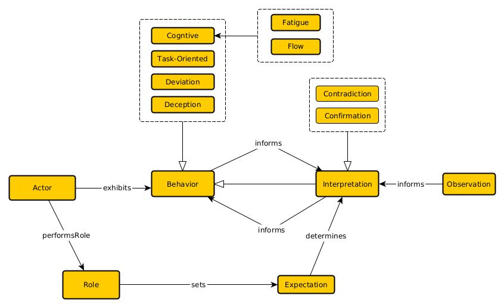
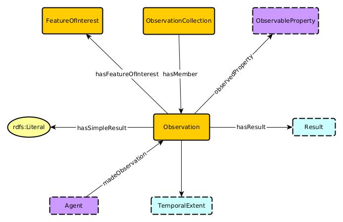

# BIO - Behavior Interpretation Ontology

## Survey

### Axioms

#### Survey hasItem SurveyItem  

* disjoint: `Survey DisjointWith SurveyItem`

* domain: `hasItem some owl:Thing SubClassOf Survey`  

* global range: `owl:Thing SubClassOf hasItem only SurveyItem`  

* Qualified Scoped Funcationality: `Survey SubClassOf hasItem min 1 SurveyITem`  
Survey has atleast one SurveyItem

#### Response answers SurveyItem  

* disjoint: `Response DisjointWith SurveyItem`
Nothing can be Response and a Survey question.
* domain: `answers some owl:Thing SubClassOf Response`  

* global range: `owl:Thing SubClassOf answers only SurveyItem`  

* funcationality: `Response SubClassOf answers exactly 1 SurveyITem`  
Each response answers exactly one Survey question.

#### Actor takesSurvey Survey  

* disjoint : `Actor DisjointWith Survey`

* scoped domain: `takesSurvey some Agent subclassOf Survey`  

* global range: `owl:Thing subClassOf takesSurvey only Survey`  

* Structural Tautology: `Actor subClassOf takesSurvey min 0 Survey`  
An Actor may take zero or more Survey.

## Instrumentation

### Axioms 
#### Actor wears Wearable  

* disjoint: `Actor DisjointWith Wearable`

* scoped domain: `wears some Wearable SubClassOf Actor`  

* scoped range: `Actor SubClassOf wears only Wearable`  

* Structural Tautology: `Actor SuClassOf wears min 0 Wearable`  
An Actor may wear zero or more Wearables.

#### Task requiresEquipment Equipment

* disjoint: `Task  DisjointWith Equipment`
Nothing can be both a Task and a piece of Equipment.

* scoped domain: `requiresEquipment some Equipment SubClassOf Task`  

* scoped range: `Task SubClassOf requiresEquipment only Equipment`  
Anything a Task requires must be Equipment.

* Structural Tautology: `Task SuClassOf requiresEquipment min 0 Equipment`  
A Task may require zero or more Equipment.

#### Wearable isLocated Location

* disjoint: `Wearble DisjointWith Location`  
  Nothing can be a wearable and a boyd part(location).
* Scoped domain: `isLocated some Location SubClassOf Wearable`  
  Anything located at a body location must be a wearable.
* Scoped range: `Wearable SubClassOf isLocated only Location`  
  Anything a wearable is located at must be a body location.
* Existential : `Wearable SubClassOf isLocated some Location`  
  Every wearable is located at at least one body location.

## Behavior Assessment

### Axioms
#### Actor exhibits Behavior
* Disjoint: `Actor DisjointWith Behavior`  
  Nothing can be both an actor and a behavior.
* Scoped domain: `exhibits some Behavior SubClassOf Actor`  
  Anything that exhibits a behavior must be an actor.
* Scoped range: `Actor SubClassOf exhibits only Behavior`  
  Anything an actor exhibits must be a behavior.
* Structural tautology: `Actor SubClassOf exhibits min 0 Behavior`  
  An actor may exhibit zero or more behaviors.
* Existential: Behavior SubClassOf exhibits some Actor  
  Every behavior is exhibited by at least one actor.
  
#### Observation informs Interpretation
* Scoped domain: `informs some Behavior SubClassOf Interpretation`  
  Anything that informs a behavior is an observation or an behavior or interpretation.
* Scoped range: `Observation SubClassOf informs only Interpretation`  
  Anything an observation informs must be a behavior or an interpretation.
* Structural tautology: `Observation SubClassOf informs min 0 Behavior` 
  An observation may inform zero or more behaviors.

#### Expectation determines Interpretation
* Disjoint: `Expectation DisjointWith Interpretation`  
  Nothing can be both an expectation and an interpretation.
* Scoped domain: `determines some Interpretation SubClassOf Expectation`  
  Anything that determines an interpretation must be an expectation.
* Scoped range: `Expectation SubClassOf determines only Interpretation`  
  Anything an expectation determines must be an interpretation.
* Structural tautology: `Expectation SubClassOf determines min 0 Interpretation`  
  An expectation may determine zero or more interpretations.
* Existential: `Interpretation SubClassOf inverse(determines) some Expectation`  
 Every interpretation is judged against at least one expectation.

## Observation

### Axioms
#### Agent madeObservation Observation
* Disjoint: `Agent DisjointWith Observation`  
  Nothing can be both an agent and an observation.
* domain: `madeObservation some owl:Thing SubClassOf Agent`  
  Anything that made an observation must be an agent.
* Range: owl: `Thing SubClassOf madeObservation only Observation`  
  Whatever anything made must be an observation.
* Structural tautology: `Agent SubClassOf madeObservation min 0 Observation`  
  An agent may make zero or more observations.

#### Observation hasResult Result
* Disjoint: `Observation DisjointWith Result`  
  Nothing can be both an observation and a result.
* Domain: `hasResult owl:Thing SubClassOf Observation`  
  Anything that has a result must be an observation.
* Range: `owl:Thing SubClassOf hasResult only Result`  
  Anything an observation has as a result must be a result.
* Existential: `Observation SubClassOf hasResult some Resul`   
  Every observation has a result.
  
#### Observation hasFeatureOfInterest FeatureOfInterest
* Disjoint:  `Observation DisjointWith FeatureOfInterest`  
  Nothing can be both an observation and the thing it’s about.
* Scoped domain:  `hasFeatureOfInterest some FeatureOfInterest SubClassOf Observation`  
  Anything that has a feature of interest must be an observation.
* Scoped range: `Observation SubClassOf hasFeatureOfInterest only FeatureOfInterest`  
  Anything an observation is about must be a feature of interest.
* Existential: `Observation SubClassOf hasFeatureOfInterest some FeatureOfInterest`  
  Every observation is about at least one thing.
