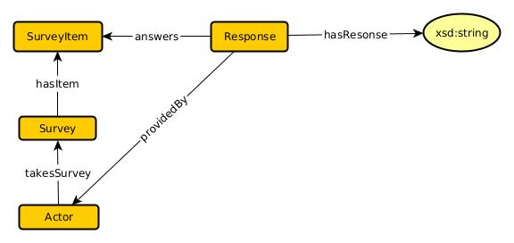

# BIO - Behavior Interpretation Ontology

## Survey

### Axioms

## Survey hasItem SurveyItem  

disjoint: `Survey DisjointWith SurveyItem`

domain: `hasItem some owl:Thing SubClassOf Survey`  

global range: `owl:Thing SubClassOf hasItem only SurveyItem`  

Qualified Scoped Funcationality: `Survey SubClassOf hasItem min 1 SurveyITem`  

## Response answers SurveyItem  

disjoint: `Response DisjointWith SurveyItem`

domain: `answers some owl:Thing SubClassOf Response`  

global range: `owl:Thing SubClassOf answers only SurveyItem`  

funcationality: `Response SubClassOf answers exactly 1 SurveyITem`  

## Actor takesSurvey Survey  

disjoint : `Actor DisjointWith Survey`

scoped domain: `takesSurvey some Agent subclassOf Survey`  

global range: `owl:Thing subClassOf takesSurvey only Survey`  

Structural Tautology: `Actor subClassOf takesSurvey min 0 Survey`  

## Instrumentation

### Axioms 
## Actor wears Wearable  

disjoint: `Actor DisjointWith Wearable`

scoped domain: `wears some Wearable SubClassOf Actor`  

scoped range: `Actor SubClassOf wears only Wearable`  

Structural Tautology: `Actor SuClassOf wears min 0 Wearable`  

## Task requires Equipment

disjoint: `Task  DisjointWith Equipment`

scoped domain: `requires some Equiment SubClassOf Task`  

scoped range: `Task SubClassOf requires only Equipment`  

Structural Tautology: `Task SuClassOf requires min 0 Equipment`  

