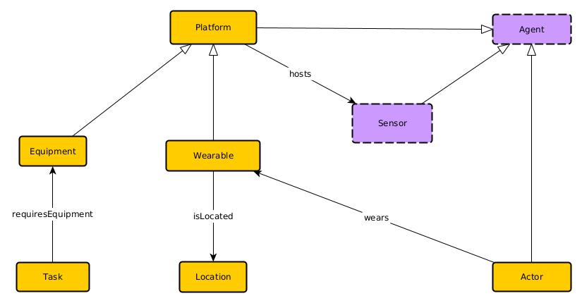

# BIO - Behavior Interpretation Ontology

## Survey

### Axioms

#### Survey hasItem SurveyItem  

* disjoint: `Survey DisjointWith SurveyItem`

* domain: `hasItem some owl:Thing SubClassOf Survey`  

* global range: `owl:Thing SubClassOf hasItem only SurveyItem`  

* Qualified Scoped Funcationality: `Survey SubClassOf hasItem min 1 SurveyITem`  
Survey has atleast one SurveyItem

#### Response answers SurveyItem  

* disjoint: `Response DisjointWith SurveyItem`
Nothing can be Response and a Survey question.
* domain: `answers some owl:Thing SubClassOf Response`  

* global range: `owl:Thing SubClassOf answers only SurveyItem`  

* funcationality: `Response SubClassOf answers exactly 1 SurveyITem`  
Each response answers exactly one Survey question.

#### Actor takesSurvey Survey  

* disjoint : `Actor DisjointWith Survey`

* scoped domain: `takesSurvey some Agent subclassOf Survey`  

* global range: `owl:Thing subClassOf takesSurvey only Survey`  

* Structural Tautology: `Actor subClassOf takesSurvey min 0 Survey`  
An Actor may take zero or more Survey.

## Instrumentation

### Axioms 
#### Actor wears Wearable  

* disjoint: `Actor DisjointWith Wearable`

* scoped domain: `wears some Wearable SubClassOf Actor`  

* scoped range: `Actor SubClassOf wears only Wearable`  

* Structural Tautology: `Actor SuClassOf wears min 0 Wearable`  
An Actor may wear zero or more Wearables.

#### Task requiresEquipment Equipment

* disjoint: `Task  DisjointWith Equipment`
Nothing can be both a Task and a piece of Equipment.

* scoped domain: `requiresEquipment some Equipment SubClassOf Task`  

* scoped range: `Task SubClassOf requiresEquipment only Equipment`  
Anything a Task requires must be Equipment.

* Structural Tautology: `Task SuClassOf requiresEquipment min 0 Equipment`  
A Task may require zero or more Equipment.
